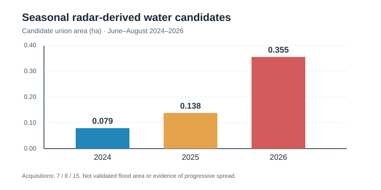

# Interannual Variation in Radar-Derived Surface-Water Candidates in Lekki, Lagos (2024–2026)

*Exploratory research note — 19 November 2026. Text adaptation of the two-page PDF research note; the original PDF contains the mapped figures.*

## Introduction and research context
Rapid urban development and intense rainfall make coastal Lagos an important setting for investigating localized surface-water dynamics. Satellite observations can reveal spatially distributed inundation signals where ground measurements are limited. Tellman et al. (2021) demonstrated the value of satellite-derived flood observations for exposure assessment, while UN-SPIDER's Sentinel-1 recommended practice emphasizes cloud-independent monitoring and urban false-positive limitations. This exploratory study examines June–August 2024–2026 without presuming that radar candidates are floods.

## Study area
The analysis covers a provisional polygon in the Lekki area of Lagos, Nigeria (approximately 3.435–3.490°E, 6.428–6.460°N). It is a project-defined area of interest, **not an official Lekki Phase 1 or Lekki Peninsula boundary**. Coastal urban surfaces and built infrastructure complicate radar interpretation.

## Methodology
Google Earth Engine Sentinel-1 GRD imagery was filtered to IW mode, 10 m resolution, descending relative orbit 95 and dual VV/VH polarization. Each acquisition was smoothed using a 30 m focal median and compared with a rolling baseline from 90–7 days earlier. Candidate pixels required decreases in both VV and VH exceeding 1.5 dB and 1.5 times historical variability (minimum standard deviation 0.5 dB), plus post-acquisition VV below −16 dB. ESA WorldCover mapped water, JRC water occurrence of at least 90%, slopes of at least 5°, and clusters smaller than eight connected pixels were excluded. At least three baseline scenes were required. Annual outputs distinguish valid observations from missing data and summarize seasonal unions and pixelwise frequencies.

## Results

| Year | Scenes | Seasonal union (ha) | Candidate pixels | Pixel detections |
|---|---:|---:|---:|---:|
| 2024 | 7 | 0.079 | 8 | 8 |
| 2025 | 8 | 0.138 | 14 | 14 |
| 2026 | 15 | 0.355 | 36 | 53 |

The candidate union increased by 74.7% from 2024 to 2025 and 157.2% from 2025 to 2026 (349.4% overall). However, acquisition opportunities also increased (7, 8 and 15), and **there was zero pixel-level overlap between the three annual footprints**. Maximum single-pixel frequencies were 14.29%, 12.50% and 13.33%, respectively. These are spatially distinct, infrequent radar candidates, not evidence of a persistent flood spreading outward.

## Spatial interpretation
A pictorial enlargement of classified raster cells is included in the original PDF report. Because annual clusters do not overlap and observation dates differ, drawing a connected flood plume would invent an unobserved process. A true flood-spread map requires sequential, independently validated within-event images.

## Uncertainty and sensitivity
August 2026 threshold tests showed strong dependence on the absolute VV cutoff: at −16 dB, candidates survived on 11 and 23 August; at −15 dB additional dates were classified; at −18 dB none survived. Earlier analyses estimated approximately 0.230 and 0.320 ha for 11 and 23 August, while a later threshold-attribution run yielded approximately 0.207 and 0.316 ha. These implementation differences remain unresolved. Limited cloud-free Sentinel-2 corroboration and a negative candidate-area MNDWI observation on 23 August did not independently establish open water. Static exclusions are not independent accuracy checks.

## Recommendations
1. Validate each candidate cluster against date-matched clear optical or high-resolution imagery, field observations, drainage records or event reports.
2. Compare years using matched acquisition opportunities or equal-sample sensitivity analysis, with observation coverage and uncertainty reported.
3. Reconcile Version 13/14 implementation differences and assess VV threshold sensitivity and classification accuracy.
4. Document an authoritative boundary and include a properly licensed contextual basemap for publication; do not extrapolate to the whole Lekki Peninsula.

## Conclusion
The workflow identified 0.079, 0.138 and 0.355 ha of seasonal radar-derived water candidates in 2024, 2025 and 2026, respectively. Candidate locations were spatially distinct, and the largest union coincided with the greatest number of acquisitions. These results offer a screening layer for targeted validation but **do not demonstrate confirmed flooding, persistent inundation or progressive flood encroachment**.

## References
- Tellman, B., Sullivan, J. A., Kuhn, C., et al. (2021). Satellite imaging reveals increased proportion of population exposed to floods. *Nature*, 596, 80–86. https://doi.org/10.1038/s41586-021-03695-w
- UN-SPIDER. *Flood Mapping and Damage Assessment Using Sentinel-1 SAR Data in Google Earth Engine: Recommended Practice.* https://un-spider.org/advisory-support/recommended-practices/recommended-practice-google-earth-engine-flood-mapping/in-detail
